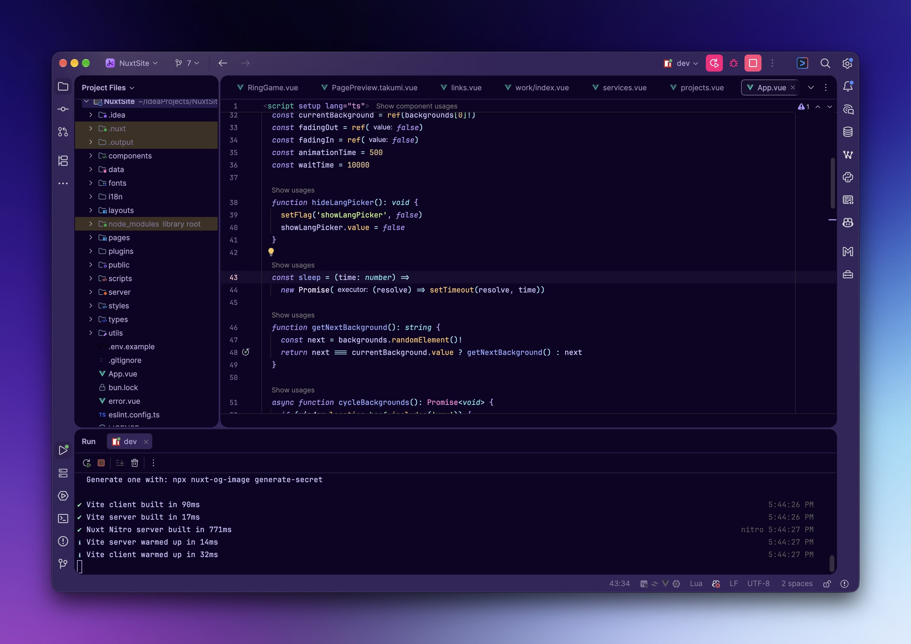
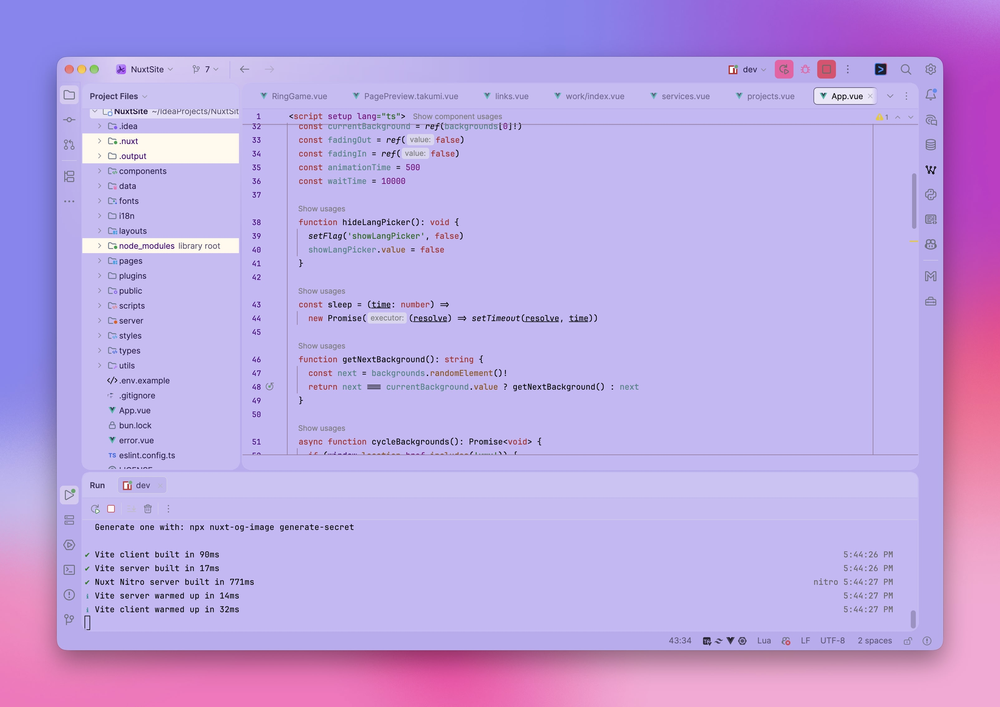

# Tokyo Purple

[Get on JetBrains Marketplace](https://l.a35.dev/tpurpij)

<!-- Plugin description -->
**Tokyo Purple** is a set of purple-tinted, Tokyo Night–inspired themes for JetBrains IDEs with soft visuals, deep contrast, and Fleet-style syntax highlighting. 
Includes light and dark mode. 

Note: this theme is currently designed primarily for HTML/CSS/JS, Vue/Nuxt, and C. While it works with other languages, the quality may vary.

## Features
- Deep purple-tinted UI theme
- Fleet-inspired syntax highlighting
- Sleek, modern look with excellent contrast
- Designed for focus and minimal eye strain
- Supports IntelliJ IDEA, WebStorm, PyCharm, CLion, Fleet, and other JetBrains IDEs

## Credits
Inspired by:
- [Tokyo Night](https://github.com/junkfactory/tokyodark-jetbrains) (This is the original repo)
- JetBrains Fleet
- Your mood at 2AM coding with lo-fi on loop
<!-- Plugin description end -->

---

Made with love for developers who dream in code and violet haze.
